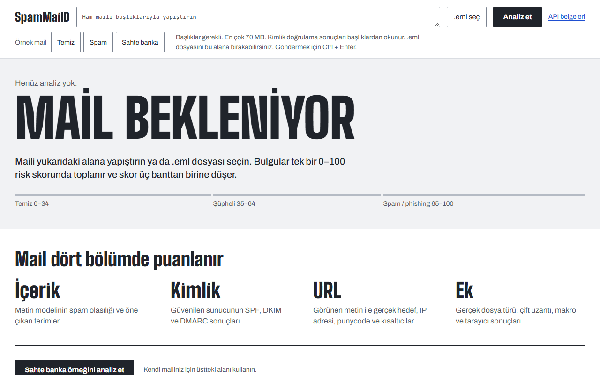
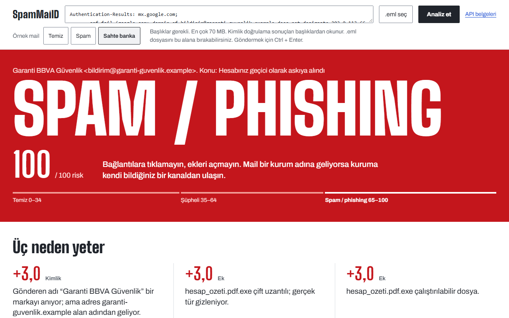
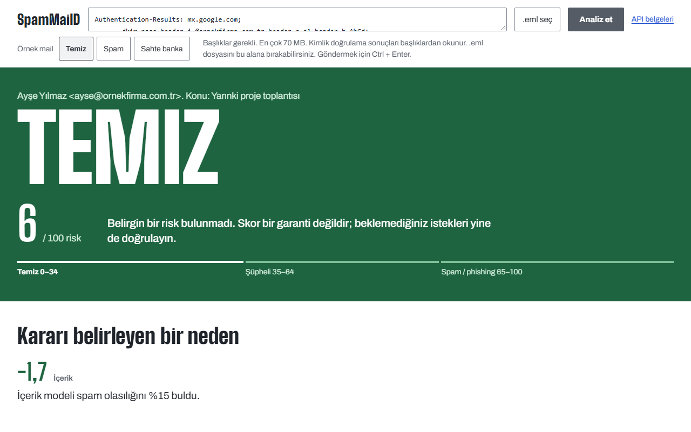
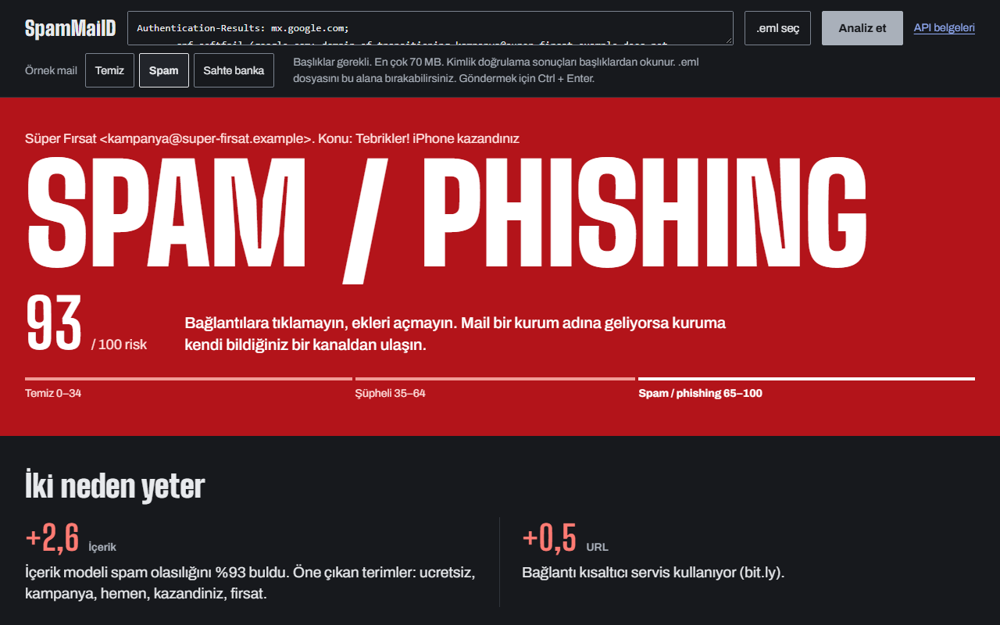
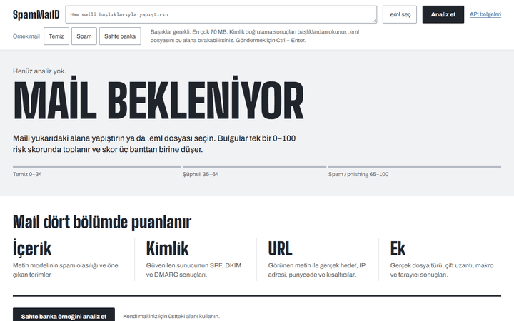
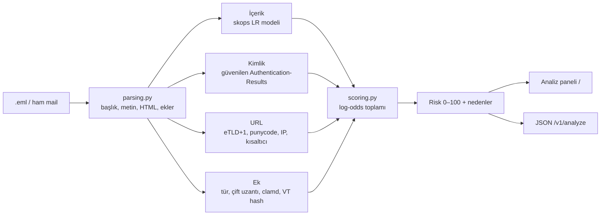

# SpamMailD — E-posta risk analizi

[](https://github.com/rose-omer/Spam-Mail-Detection/actions/workflows/ci.yml)


SpamMailD bir `.eml` dosyasını ya da ham maili alır ve tek bir risk skoru (0–100) ile neden listesi döner.
Dört analiz ayrı ayrı çalışır: içerik modeli, kimlik doğrulama (SPF/DKIM/DMARC), URL ve ek analizi.
Servis hiçbir bağlantıyı açmaz ya da indirmez.

> **English summary.** SpamMailD is a FastAPI service and web panel that scores raw emails (`.eml`)
> for spam and phishing. It combines a content model, trusted `Authentication-Results` parsing,
> offline URL heuristics (eTLD+1, punycode, IP literals, link-text mismatch) and attachment checks
> (magic bytes, double extensions, macros, clamd and VirusTotal hash lookup) into one 0–100 risk score
> with human-readable reasons. No URL is ever fetched.

## Proje hakkında

Bu proje, **EMAR Proje** şirketinde gerçekleştirdiğim staj süresince geliştirilmiştir.
Projede, staj sorumlusu **Mehmet Emre Doğan**’ın verdiği onaylar ve yönlendirmeler doğrultusunda
ilerlenmiş ve tamamlanmıştır. Sürüm 2 aynı fikri güvenli ve testli bir servise taşır.

## Ekran görüntüleri

Görüntüler demo kipinde, uygulamanın kendi örnek mailleriyle alındı. Dış servisler (ClamAV, VirusTotal) bu kipte kapalı.

| | |
|---|---|
| <br>Boş panel | <br>Sahte banka maili: oltalama kararı |
| <br>Temiz mail | <br>Koyu tema |

## Kullanım



Mail yapıştırılır ya da .eml dosyası seçilir. Panel kararı, puanı ve kararı belirleyen üç nedeni gösterir.

## Mimari



- Her analiz bir `Signal(ad, skor, ağırlık, neden, durum)` döner. `scoring.py` sinyalleri log-odds
  üzerinden toplar. Hiçbir sinyal başka bir sinyali silmez.
- Bantlar: 0–34 temiz, 35–64 şüpheli, 65–100 spam / phishing.
- Bir analiz hata verirse diğerleri sürer; hatalı bölüm `error` durumuyla rapora yazılır.

## Hızlı başlangıç

Gereken: Python 3.12 ya da üstü. Önerilen: [uv](https://docs.astral.sh/uv/).

```bash
git clone https://github.com/rose-omer/Spam-Mail-Detection.git
cd Spam-Mail-Detection
uv sync                      # ya da: python -m venv .venv && pip install -e . pytest ruff
cp .env.example .env         # API_KEY ve TRUSTED_AUTHSERV_ID değerlerini doldurun
uv run uvicorn spammaild.main:create_app --factory --host 127.0.0.1 --port 8100
```

- Panel: <http://127.0.0.1:8100/>
- Swagger: <http://127.0.0.1:8100/docs>
- Dış servis olmadan denemek için: `DEMO_MODE=true`.
- `API_KEY` boşsa sunucu başlamaz. Yalnız yerel geliştirmede anahtarsız açmak için
  `ALLOW_NO_AUTH=true` verin.

### Docker Compose

```bash
cp .env.example .env         # API_KEY zorunlu
docker compose up --build    # api: 127.0.0.1:8100, clamav: yalnız iç ağ
```

ClamAV konteyneri 3–4 GiB bellek ister ve ilk açılışta imzaları indirir (birkaç dakika).

### curl örneği

```bash
curl -s http://127.0.0.1:8100/v1/analyze \
  -H "X-API-Key: $API_KEY" \
  -H "Content-Type: message/rfc822" \
  --data-binary @tests/fixtures/href_mismatch.eml

curl -s http://127.0.0.1:8100/v1/analyze -H "X-API-Key: $API_KEY" -F "file=@mail.eml"

curl -s http://127.0.0.1:8100/v1/analyze/text -H "X-API-Key: $API_KEY" \
  -H "Content-Type: application/json" -d '{"text": "Tebrikler, ödül kazandınız!"}'
```

Yanıt özeti:

```json
{
  "risk": 100,
  "band": "spam",
  "reasons": [
    {"source": "auth", "text": "DMARC denetimi başarısız.", "impact": 3.0, "status": "ok"},
    {"source": "url", "text": "Bağlantı metni www.garantibbva.com.tr gösteriyor; hedef garantibbva.com.tr.hesap-dogrula.example.", "impact": 2.4, "status": "ok"}
  ],
  "auth": {"spf": {"result": "fail", "source": "Authentication-Results: mx.google.com"}},
  "urls": [], "attachments": [], "message": {}, "model": {}
}
```

### İstemci (IMAP)

```bash
export EMAIL_ACCOUNT=ben@gmail.com EMAIL_APP_PASSWORD=uygulama-sifresi API_KEY=...
python client.py fetch --limit 5      # BODY.PEEK[] kullanır; mailler "okundu" olmaz
python client.py analyze mail.eml
```

Google, 2025-03-14'ten beri normal parola ile IMAP girişini kabul etmiyor. İki adımlı doğrulama açık
hesapta bir uygulama şifresi oluşturun.

## Ayarlar

Bütün ayarlar `.env.example` içinde açıklamalıdır. Önemlileri:

| Değişken | Varsayılan | Açıklama |
|---|---|---|
| `API_KEY` | boş | `/v1` için `X-API-Key`. Boşsa sunucu başlamaz. |
| `ALLOW_NO_AUTH` | `false` | `true` iken `API_KEY` olmadan başlar; uç noktalar anahtarsızdır. Yalnız yerelde. |
| `TRUSTED_AUTHSERV_ID` | boş | Yalnız en üstteki `Authentication-Results` okunur; `authserv-id` bu değer olmalı. |
| `DEMO_MODE` | `false` | `true` iken VirusTotal, URLhaus ve ClamAV kapalıdır. |
| `VT_API_KEY`, `VT_UPLOAD` | boş, `false` | Önce sha256 sorgusu. Yükleme yalnız `VT_UPLOAD=true` ile; panel kırmızı uyarı gösterir. |
| `VT_POLL_ATTEMPTS`, `VT_POLL_INTERVAL_S` | `3`, `5` | Yüklemeden sonra analiz sonucu en çok bu kadar sorulur; bitmezse `unknown`. |
| `URLHAUS_AUTH_KEY`, `OPENPHISH_FEED_PATH` | boş | URL itibarı. Adres `#` kısmı atılarak URLhaus'a gider; sorgu parametreleri gider. Feed dosyası yerelde tutulur. |
| `MAX_REQUEST_MB`, `MAX_TEXT_REQUEST_MB` | `70`, `2` | Gövde sınırı: büyük sınır yalnız `/v1/analyze` içindir; diğer yollar küçük sınırı kullanır. |
| `CLAMD_HOST`, `CLAMD_PORT` | boş, `3310` | clamd INSTREAM taraması. |
| `MODEL_BACKEND`, `MODEL_PATH` | `legacy-lr`, `models/legacy-lr` | `baseline-char` ya da `onnx-transformer` da seçilebilir. |
| `TRANSFORMER_MODEL_NAME` | `jhu-clsp/mmBERT-base` | Eğitim betiğinin varsayılan taban modeli. |

## İçerik modeli

| Model | Durum | Not |
|---|---|---|
| `legacy-lr` | Serviste varsayılan | Staj sürümünün LR modelleri. Pickle yerine skops; sha256 denetimli. [Model kartı](models/legacy-lr/model_card.md) |
| `baseline-char` | Betik hazır, eğitilmedi | char_wb (3,5) TF-IDF + LR, TR ve EN tek model (`training/train_baseline.py`). |
| mmBERT / TabiBERT | Betik ve ONNX adaptörü hazır, eğitilmedi | `training/train_transformer.py` → `models/<ad>/model.onnx`. |

Ölçüt tablosu `reports/metrics.json` dosyasından doldurulur. Dosya henüz yok: eski modelin eğitim
verisi bilinmiyor ve yeni modeller eğitilmedi. Üretmek için:

```bash
python -m training.prepare --source uci_tr=data/raw/uci_tr.csv:text:label --source enron=data/raw/enron.csv:text:label
python -m training.train_baseline
python -m training.evaluate --backend baseline-char --model-path models/baseline-char
```

### Veri seti lisansları

| Veri seti | Dil | Lisans |
|---|---|---|
| UCI Turkish Spam V01 | TR | CC BY 4.0 |
| `anilguven/turkish_spam_email` | TR | belirtilmemiş; UCI ile kopya olabilir |
| OLTA-TR (Zenodo) | TR | CC BY 4.0; sentetik, yalnız eğitimde |
| `SetFit/enron_spam` | EN | veri setinin kartına bakın |
| SpamAssassin public corpus | EN | Apache SpamAssassin projesi koşulları |
| `zefang-liu/phishing-email-dataset` | EN | LGPL-3.0 |

## Güvenlik notları

- Hiçbir URL indirilmez. Eski sürümdeki sunucu taraflı indirme (SSRF) kaldırıldı; test bunu soket
  çağrılarını yasaklayarak doğrular (`tests/test_no_ssrf.py`).
- Alan adları `tldextract` ile kayıtlı alan adına (eTLD+1) indirgenir ve eşitlikle karşılaştırılır.
  `paypal.com.evil.io` artık `paypal.com` ile "uyumlu" sayılmaz.
- Gövdede ya da sahte başlıkta yazan `spf=pass` metni yok sayılır.
- VirusTotal ve clamd hata, kota ya da zaman aşımında `clean` değil `unknown` / `error` döner.
- Model dosyaları pickle değildir; skops yalnız beklenen tipleri açar ve sha256 `metadata.json` ile eşleşmelidir.
- Yalnız en üstteki `Authentication-Results` başlığı okunur. Üstteki başlık güvenilen sunucudan değilse
  alttaki "güvenilen" görünümlü başlık da yok sayılır.
- Gövdesi, konusu, göndereni ve eki olmayan girdi `422` döner; skorlanamayan girdi "temiz" sayılmaz.
- İstek gövdesi sınırı (`/v1/analyze` 70 MB, diğer yollar 2 MB), ek sınırı (tek dosya 25 MB, toplam
  50 MB) ve bellek içi hız sınırı vardır. API anahtarı ve hız sınırı gövde okunmadan denetlenir.
- Hız sınırı istemci adresini `request.client.host` ile okur. Ters vekil arkasında uvicorn'u
  `--proxy-headers --forwarded-allow-ips=<vekil IP>` ile çalıştırın; yoksa bütün istemciler tek sayaç paylaşır.
- Panel katı bir Content-Security-Policy ile sunulur; mail içeriği DOM'a yalnız metin olarak yazılır.

## Bilinen sınırlar

- Dil tahmini basit bir sözcük ve harf sayımıdır; çok kısa metinde yanılabilir.
- DKIM imzası yerelde doğrulanmaz ve DMARC politikası DNS'ten okunmaz; bu iki iş ağ ister.
- Hız sınırı tek süreç içindir; birden çok worker için paylaşılan bir depo gerekir.
- Sinyal ağırlıkları elle ayarlandı. Doğrulama kümesi gelince yeniden ayarlanmalı.

## Geliştirme

```bash
uv run ruff check . && uv run ruff format --check .
uv run pytest -q                        # entegrasyon testi hariç
CLAMD_HOST=127.0.0.1 uv run pytest -m integration   # çalışan clamd gerekir
```

## Proje yapısı

```text
spammaild/
  main.py            uygulama fabrikası, hata yakalayıcılar, panel
  settings.py        ortam değişkenleri
  parsing.py         RFC 5322 ayrıştırma, HTML → metin, ekler
  scoring.py         Signal, ağırlıklar, bantlar
  service.py         analiz hattı
  api/               /v1 uç noktaları, API anahtarı, gövde ve hız sınırı
  analyzers/         content, auth, urls, attachments
  clients/           clamd, VirusTotal, URLhaus, OpenPhish
  web/               panel şablonu, CSS, JS, örnek mailler
models/legacy-lr/    skops modelleri, metadata.json, model kartı
training/            prepare, train_baseline, train_transformer, evaluate, convert_legacy
tests/               birim, API ve SSRF testleri, .eml fixture'ları
client.py            IMAP istemcisi
```

## Lisans

Lisans dosyası henüz eklenmedi. Kodun ve modellerin lisansı staj yapılan şirketle netleşince eklenecek.
